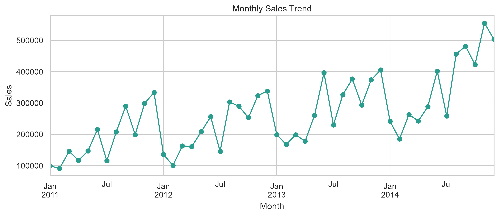
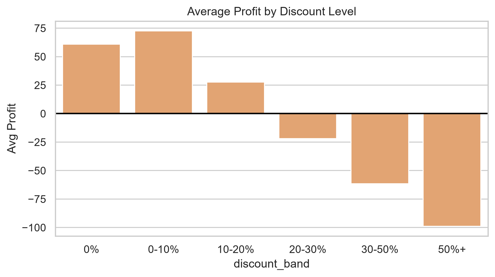

# CodeAlpha Internship – Task 2: Data Visualization

## Objective
Transform raw sales data into clear visuals and data stories that support business decisions.

## Dataset
Global Superstore Sales Dataset (Kaggle): 51,290 orders, 2011-2014.
https://www.kaggle.com/datasets/laibaanwer/superstore-sales-dataset

## Tools Used
Python, Pandas, NumPy, Matplotlib, Seaborn, Jupyter Notebook

## Visualizations
- Monthly sales trend (line chart)
- Sales and profit by category (bar chart)
- Sales share by segment (donut chart)
- Sales by market (bar chart)
- Profit distribution (histogram)
- Correlation heatmap
- Profit outliers by category (box plot)
- Top 10 products by profit
- Average profit by discount level

## Key Insights
- Sales grew about 90% from 2011 to 2014, with a peak in Nov-Dec.
- Consumer customers contribute 51.5% of sales.
- Discounts above 20% push average profit below zero.
- Sales and shipping cost are strongly correlated (0.77).
- Technology products dominate the top 10 by profit.

## Recommendations
- Stock up before the Sep-Dec peak season.
- Cap discounts at around 20%.
- Review shipping costs on large orders.

## Project Structure
```
CodeAlpha_DataVisualization/
├── data/
├── images/
├── notebook.ipynb
└── README.md
```

## How to Run
1. Download the dataset from Kaggle and place it in `data/`.
2. Install libraries: `pip install pandas numpy matplotlib seaborn jupyter`
3. Open `notebook.ipynb` and run all cells.

## Screenshots



*Internship task completed at CodeAlpha.*
